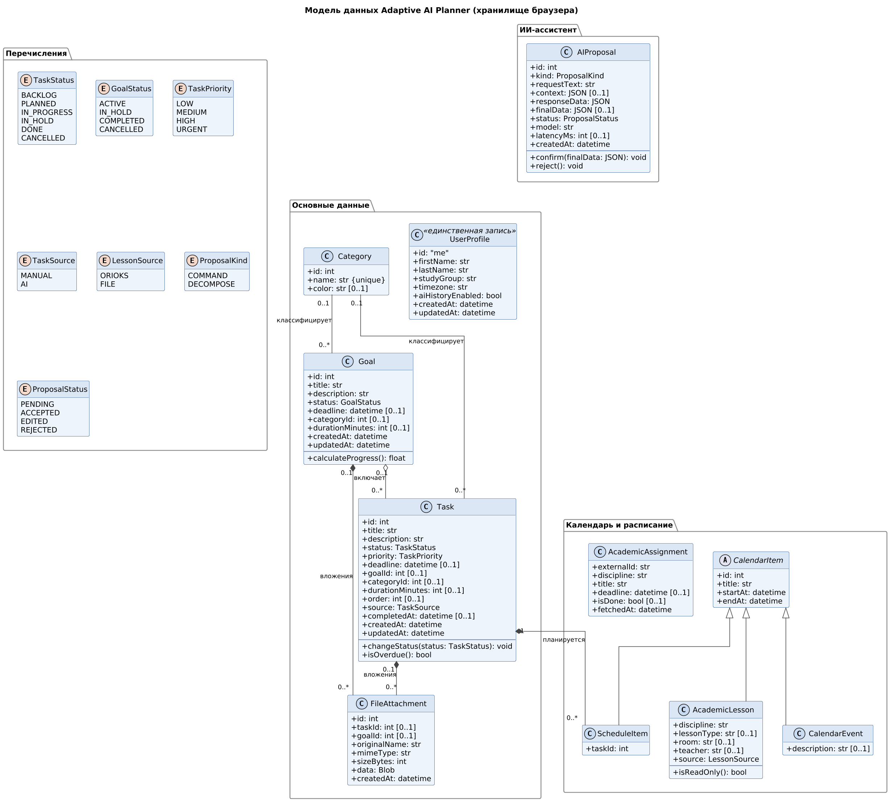

# Модель данных Adaptive AI Planner

Версия 2.0 · соответствует ТЗ v11 и диаграмме классов CL-01

Документ описывает данные, которые Система хранит в браузере пользователя (IndexedDB). Он служит общим ориентиром для диаграмм UML, модуля хранилища [`docs/storage/db.ts`](../docs/storage/db.ts) и формата резервной копии. Серверная часть пользовательские данные не хранит, поэтому серверной базы данных в проекте нет.

## Основа и изменения

Модель построена на диаграмме классов проекта. Классы, их названия и связи сохранены. Изменено то, что противоречило ТЗ v11:

| Было на диаграмме классов | Стало | Причина |
|---|---|---|
| `User` с `email` и `passwordHash`, связи «владеет» со всеми объектами | `UserProfile` — единственная запись профиля, без связей владения | Регистрации и учётных записей нет, все данные принадлежат одному пользователю браузера (п. 4.2 ТЗ) |
| В профиле нет учебной группы | `studyGroup`, `aiHistoryEnabled` | Группа нужна для расписания ОРИОКС (ФТ-01, ФТ-23); историю ИИ можно отключить (ФТ-40) |
| `Task.externalId` — задания ОРИОКС хранились как задачи | Отдельный класс `AcademicAssignment` | Учебные задания показываются отдельным списком и не смешиваются с задачами пользователя (ФТ-26) |
| `FileAttachment.storageKey` — файл во внешнем хранилище | `FileAttachment.data: Blob` | Файлы хранятся в браузере вместе с остальными данными (ФТ-02) |
| `ProposalStatus`: PENDING, CONFIRMED, REJECTED | PENDING, ACCEPTED, EDITED, REJECTED | В истории фиксируется итог «принято», «изменено» или «отклонено» (ФТ-40) |
| У задачи и цели нет длительности | `durationMinutes` у задачи и цели, необязательная | ФТ-07, ФТ-10 |
| Нет порядка задач, источника задачи и даты изменения | `Task.order`, `Task.source`, `updatedAt` | Порядок задач из декомпозиции ИИ (ФТ-37) |

Рабочие сессии и фактическое время работы в модель не входят.

Исходник рисунка — [`data_model.puml`](data_model.puml). Он подключает те же описания классов, что и диаграмма CL-01 (`docs/uml/puml/CL-01_entities.iuml`), поэтому модель и диаграмма классов не расходятся.

## Общие правила хранения

- Дата и время хранятся строкой ISO 8601 в UTC, например `2026-11-02T09:00:00.000Z`, и показываются в часовом поясе из профиля.
- Длительность хранится в минутах, целым положительным числом.
- Перечисления хранятся кодами (таблица 1 ТЗ и раздел «Перечисления»).
- Необязательное поле без значения отсутствует в записи.
- Первичные ключи целые и назначаются хранилищем автоматически. Исключения: профиль (`"me"`) и учебное задание (идентификатор из ОРИОКС).
- Действия, меняющие несколько записей, выполняются в одной транзакции (НД-03).

## Перечисления

| Перечисление | Значения | Где используется |
|---|---|---|
| `TaskStatus` | BACKLOG «Бэклог», PLANNED «Запланирована», IN_PROGRESS «В процессе», IN_HOLD «Приостановлена», DONE «Выполнена», CANCELLED «Отменена» | `Task.status` |
| `GoalStatus` | ACTIVE «Активна», IN_HOLD «Приостановлена», COMPLETED «Достигнута», CANCELLED «Отменена» | `Goal.status` |
| `TaskPriority` | LOW «Низкий», MEDIUM «Средний», HIGH «Высокий», URGENT «Срочный» | `Task.priority` |
| `TaskSource` | MANUAL — создана пользователем; AI — создана по подтверждённому предложению ИИ | `Task.source` |
| `LessonSource` | ORIOKS — из ОРИОКС; FILE — из файла расписания | `AcademicLesson.source` |
| `ProposalKind` | COMMAND — текстовый запрос (ФТ-36); DECOMPOSE — декомпозиция цели (ФТ-37) | `AIProposal.kind` |
| `ProposalStatus` | PENDING — ждёт решения; ACCEPTED — принято; EDITED — принято с правками; REJECTED — отклонено | `AIProposal.status` |

## Сущности

### UserProfile — профиль пользователя

Таблица `profile`. Одна запись с `id = "me"`. ФТ-01.

| Поле | Тип | Обязательно | Описание |
|---|---|---|---|
| id | `"me"` | да | Ключ единственной записи |
| firstName | строка | да | Имя |
| lastName | строка | да | Фамилия |
| studyGroup | строка | да | Учебная группа для расписания ОРИОКС |
| timezone | строка | да | Часовой пояс IANA, например `Europe/Moscow` |
| aiHistoryEnabled | логическое | да | Сохранять ли историю запросов к ИИ; по умолчанию да |
| createdAt, updatedAt | дата и время | да | Создание и последнее изменение |

### Category — категория

Таблица `categories`, индексы: `&name` (уникальный). ФТ-14–ФТ-16.

| Поле | Тип | Обязательно | Описание |
|---|---|---|---|
| id | целое | да | Ключ |
| name | строка | да | Название, уникальное |
| color | строка `#RRGGBB` | нет | Цвет в интерфейсе |

### Goal — цель

Таблица `goals`, индексы: `status`, `categoryId`, `deadline`. ФТ-10–ФТ-13.

| Поле | Тип | Обязательно | Описание |
|---|---|---|---|
| id | целое | да | Ключ |
| title | строка | да | Название |
| description | строка | да | Описание желаемого результата (может быть пустым) |
| status | `GoalStatus` | да | Статус; новая цель — ACTIVE |
| deadline | дата и время | нет | Срок достижения |
| categoryId | целое → Category | нет | Категория |
| durationMinutes | целое > 0 | нет | Длительность цели; хранится отдельно от длительностей её задач и не нужна для декомпозиции |
| createdAt, updatedAt | дата и время | да | Создание и последнее изменение |

Прогресс цели не хранится, а вычисляется (`calculateProgress`): доля задач в статусе DONE среди всех неотменённых задач цели (ФТ-12).

### Task — задача

Таблица `tasks`, индексы: `status`, `priority`, `goalId`, `categoryId`, `deadline`, `[goalId+order]`. ФТ-06–ФТ-09, ФТ-30, ФТ-31.

| Поле | Тип | Обязательно | Описание |
|---|---|---|---|
| id | целое | да | Ключ |
| title | строка | да | Название |
| description | строка | да | Описание (может быть пустым) |
| status | `TaskStatus` | да | Статус; новая задача — BACKLOG |
| priority | `TaskPriority` | да | Приоритет |
| deadline | дата и время | нет | Дедлайн |
| goalId | целое → Goal | нет | Цель, в которую входит задача |
| categoryId | целое → Category | нет | Категория; может отличаться от категории цели |
| durationMinutes | целое > 0 | нет | Длительность задачи |
| order | целое | нет | Порядок выполнения внутри цели (из декомпозиции ИИ) |
| source | `TaskSource` | да | Кто создал задачу |
| completedAt | дата и время | нет | Ставится при переходе в DONE и удаляется при выходе из DONE |
| createdAt, updatedAt | дата и время | да | Создание и последнее изменение |

Просроченность не хранится, а вычисляется (`isOverdue`): дедлайн прошёл, а статус не DONE и не CANCELLED (ФТ-31).

### CalendarItem и его наследники — календарь

`CalendarItem` — абстрактный класс с общими полями всех элементов календаря. ФТ-21–ФТ-25.

| Поле | Тип | Обязательно | Описание |
|---|---|---|---|
| id | целое | да | Ключ |
| title | строка | да | Название в календаре |
| startAt | дата и время | да | Начало |
| endAt | дата и время | да | Конец, всегда позже начала (НД-04) |

| Наследник | Таблица и индексы | Дополнительные поля | Смысл |
|---|---|---|---|
| `CalendarEvent` | `calendarEvents`: `startAt`, `endAt` | description — строка, необязательно | Личное событие пользователя (ФТ-22) |
| `ScheduleItem` | `scheduleItems`: `taskId`, `startAt`, `endAt` | taskId → Task, обязательно | Интервал выполнения задачи (ФТ-22) |
| `AcademicLesson` | `academicLessons`: `startAt`, `source` | discipline — дисциплина; lessonType, room, teacher — необязательно; source — `LessonSource` | Учебное занятие; только просмотр (ФТ-23, ФТ-24) |

Новое расписание полностью заменяет занятия из того же источника. Пересечения между элементами календаря вычисляются и не хранятся (ФТ-25).

### AcademicAssignment — учебное задание

Таблица `academicAssignments`, ключ `externalId`, индексы: `deadline`, `discipline`. ФТ-26–ФТ-29.

| Поле | Тип | Обязательно | Описание |
|---|---|---|---|
| externalId | строка | да | Идентификатор задания в ОРИОКС; по нему задание обновляется при повторной загрузке |
| discipline | строка | да | Дисциплина |
| title | строка | да | Задание или контрольное мероприятие |
| deadline | дата и время | нет | Срок сдачи |
| isDone | логическое | нет | Признак выполнения, если ОРИОКС его передаёт |
| fetchedAt | дата и время | да | Когда данные получены из ОРИОКС |

### FileAttachment — файл

Таблица `fileAttachments`, индексы: `taskId`, `goalId`. ФТ-32–ФТ-34.

| Поле | Тип | Обязательно | Описание |
|---|---|---|---|
| id | целое | да | Ключ |
| taskId | целое → Task | одно из двух | Задача, к которой прикреплён файл |
| goalId | целое → Goal | одно из двух | Цель, к которой прикреплён файл |
| originalName | строка | да | Имя файла |
| mimeType | строка | да | Тип файла |
| sizeBytes | целое | да | Размер; лимиты — приложение В ТЗ |
| data | Blob | да | Содержимое файла |
| createdAt | дата и время | да | Когда файл прикреплён |

Заполняется ровно одно из полей `taskId` и `goalId`. В карточке задачи показываются файлы задачи и файлы её цели без копирования. Содержимое файлов не передаётся на сервер и в языковую модель.

### AIProposal — предложение ИИ

Таблица `aiProposals`, индексы: `createdAt`, `kind`, `status`. ФТ-35–ФТ-40.

| Поле | Тип | Обязательно | Описание |
|---|---|---|---|
| id | целое | да | Ключ |
| kind | `ProposalKind` | да | Тип запроса |
| requestText | строка | да | Текст запроса пользователя |
| context | JSON | нет | Что ещё передано модели: дата, часовой пояс, названия целей, категорий, задач и событий |
| responseData | JSON | да | Ответ ИИ после проверки формата (ФТ-38) |
| finalData | JSON | нет | Что пользователь подтвердил, с учётом правок |
| status | `ProposalStatus` | да | Итог; новое предложение — PENDING |
| model | строка | да | Модель, которая дала ответ |
| latencyMs | целое | нет | Время ответа |
| createdAt | дата и время | да | Время запроса |

Записи создаются, только если в профиле включена история. История выгружается в отдельный JSON-файл; эти данные можно использовать для обучения собственной модели.

## Связи и правила удаления

| Связь | Кратность | Что происходит при удалении |
|---|---|---|
| Goal — Task | 0..1 : 0..* | Удаление цели: задачи остаются без цели, их `goalId` и `order` очищаются (ФТ-13) |
| Category — Goal, Category — Task | 0..1 : 0..* | Удаление категории: цели и задачи остаются без категории (ФТ-16) |
| Task — ScheduleItem | 1 : 0..* | Удаление задачи удаляет её интервалы (ФТ-09) |
| Task — FileAttachment | 0..1 : 0..* | Удаление задачи удаляет её файлы (ФТ-09) |
| Goal — FileAttachment | 0..1 : 0..* | Удаление цели удаляет файлы самой цели (ФТ-13) |
| CalendarItem — CalendarEvent, ScheduleItem, AcademicLesson | наследование | — |

Перед удалением задачи и цели Система считает связанные записи и показывает их в окне подтверждения (ФТ-09, ФТ-13). Все каскадные изменения выполняются одной транзакцией.

## Проверки данных (НД-04)

- обязательные поля заполнены: названия, поля профиля;
- длительность — целое положительное число минут;
- конец интервала позже начала;
- связанные записи существуют: задача у интервала, задача или цель у файла, цель при создании задач из декомпозиции;
- название категории уникально;
- размер и тип файла соответствуют приложению В.

## Резервная копия

Резервная копия — JSON-файл со всеми таблицами, включая содержимое файлов в base64 (ФТ-03). Перед восстановлением Система проверяет файл целиком (ФТ-04):

1. файл является копией Adaptive AI Planner: формат и имя базы;
2. версия схемы не новее текущей;
3. файл прочитан до конца и содержит все заявленные строки каждой таблицы.

Только после этого текущие данные заменяются. Перед заменой делается снимок; если импорт не удался, данные возвращаются из снимка.

## Соответствие требованиям

| Сущность | ФТ |
|---|---|
| UserProfile | ФТ-01, ФТ-02, ФТ-23, ФТ-40 |
| Category | ФТ-14–ФТ-16 |
| Goal | ФТ-10–ФТ-13, ФТ-37 |
| Task | ФТ-06–ФТ-09, ФТ-11, ФТ-17–ФТ-20, ФТ-30, ФТ-31 |
| CalendarEvent, ScheduleItem | ФТ-21, ФТ-22, ФТ-25 |
| AcademicLesson | ФТ-21, ФТ-23–ФТ-25 |
| AcademicAssignment | ФТ-26–ФТ-29 |
| FileAttachment | ФТ-32–ФТ-34 |
| AIProposal | ФТ-35–ФТ-40 |
| Все таблицы | ФТ-03–ФТ-05 (резервная копия и удаление данных) |
